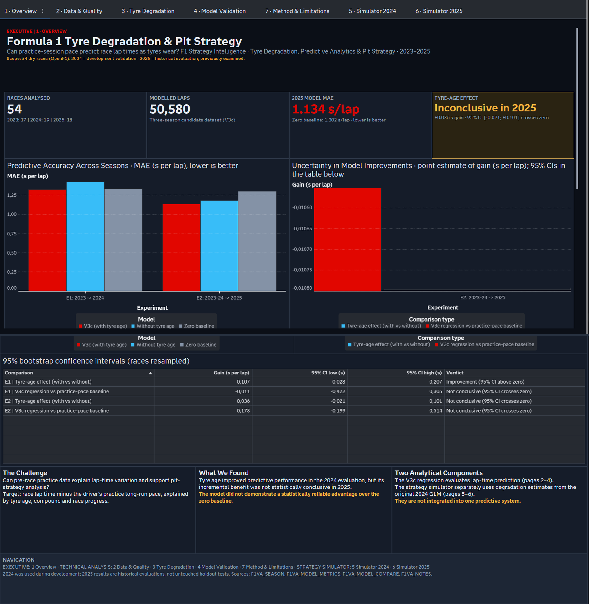
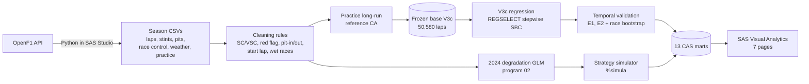
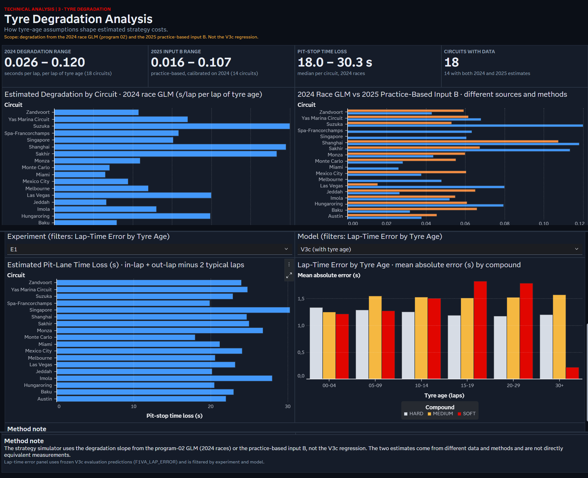
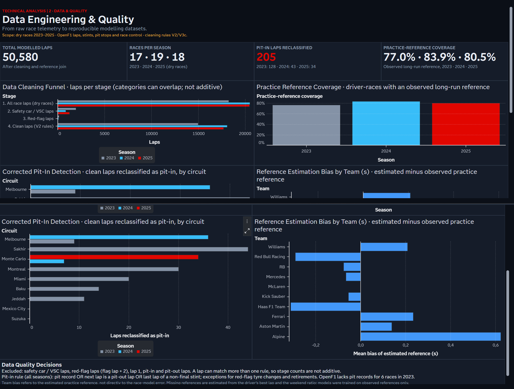
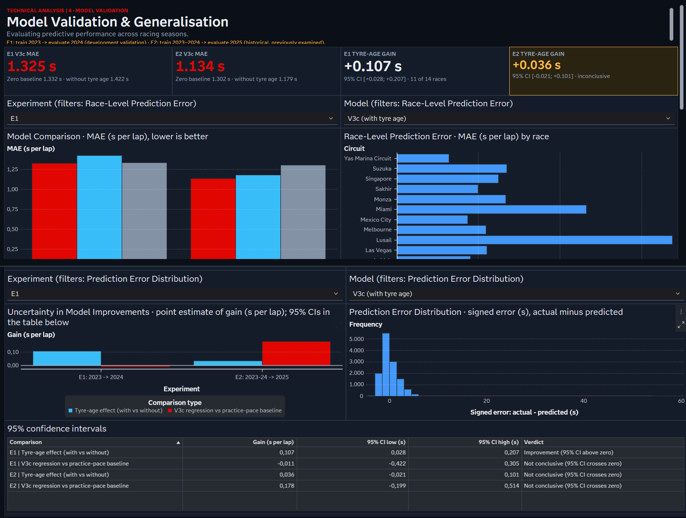
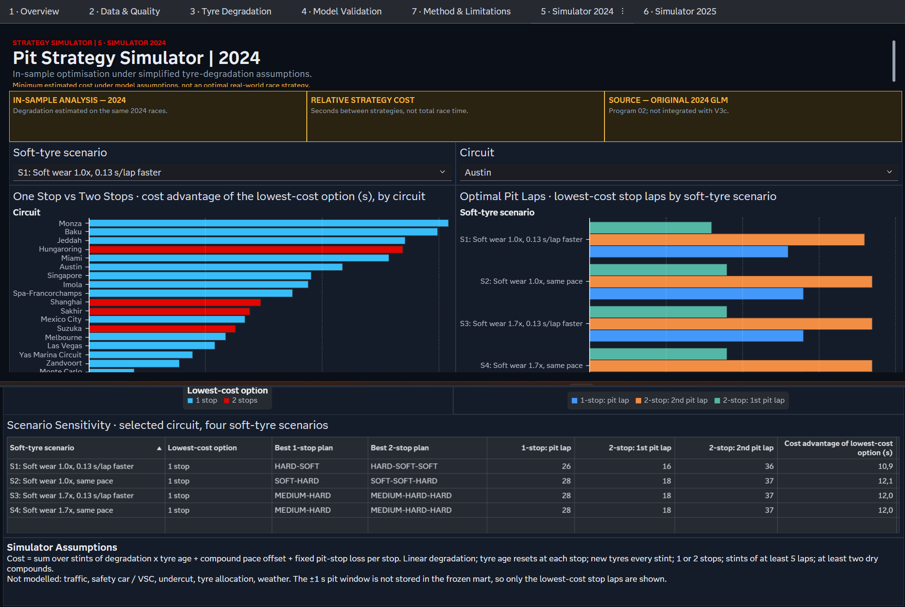
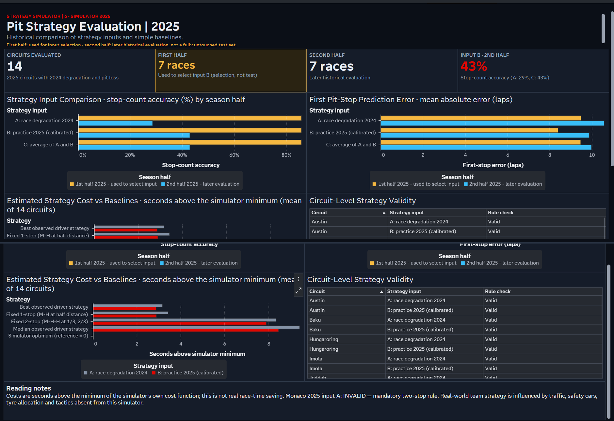
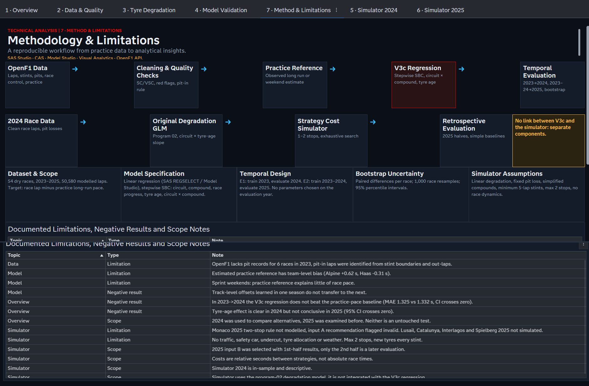

# F1 Strategy Intelligence · 2023–2025

**Can Friday practice pace predict Formula 1 race lap times as tyres wear, and what does a simple pit-strategy model say about one- vs two-stop races?**

An end-to-end, audited analytics project on three seasons of public [OpenF1](https://openf1.org) timing data. It covers data engineering, statistical modelling, temporal validation with race-level bootstrap, a pit-strategy cost simulator and a seven-page SAS Visual Analytics dashboard, all built in SAS Viya (SAS Studio, CAS, Model Studio and Visual Analytics).

The project reports its negative results as plainly as its positive ones.



---

## At a glance

| | |
|---|---|
| Dry races analysed | **54** (2023: 17 · 2024: 19 · 2025: 18) |
| Race laps in the frozen modelling base (V3c) | **50,580** |
| V3c lap-time MAE: E1 (train 2023 → evaluate 2024) | **1.325 s/lap** (zero baseline 1.332 · without tyre age 1.422) |
| V3c lap-time MAE: E2 (train 2023–24 → evaluate 2025) | **1.134 s/lap** (zero baseline 1.302 · without tyre age 1.179) |
| Tyre-age gain, E1 | **+0.107 s/lap**, 95% CI [+0.028; +0.207]: improvement |
| Tyre-age gain, E2 | **+0.036 s/lap**, 95% CI [−0.021; +0.101]: inconclusive |
| V3c vs zero (practice-pace) baseline | E1 −0.011 [−0.422; +0.305] · E2 +0.178 [−0.199; +0.514]: **no statistically reliable advantage** |
| Strategy simulator, 2025 retrospective | 14 circuits; input B stop-count accuracy **43%** in the 2nd half of 2025 |

The headline finding is mixed. Adding tyre age improves predictions clearly in one season and inconclusively in the next. Neither model reliably beats the simple practice-pace baseline.

## Research question

Teams run long stints in Friday practice to read tyre behaviour before the race. This project asks whether that public signal is enough to predict race pace as tyres age.

1. **Lap-time model.** The target is *race lap time minus the driver's practice long-run reference*. It is modelled with circuit, compound, race progress and tyre age.
2. **Strategy model.** A separate, deliberately simple cost model asks how one- and two-stop strategies compare, given per-circuit degradation and pit-lane loss.

> The two components are **independent**. The strategy simulator uses degradation slopes from the original 2024 GLM (program 02). It is **not** driven by the V3c regression.

## Technology stack

| Layer | Tools |
|---|---|
| Ingestion | Python 3 (`urllib`, `pandas`) run inside SAS Studio (`PROC PYTHON`), OpenF1 REST API |
| Processing and modelling | SAS 9.4/Viya: DATA step, `PROC SQL`, `PROC GLM`, CAS actions, `PROC REGSELECT`, `PROC FOREST`, `PROC GRADBOOST`, `PROC QUANTREG`, `PROC SURVEYSELECT` |
| Model exploration | SAS Model Studio (early pipelines; reproduced in code in program 11) |
| Dashboard | SAS Visual Analytics (13 CAS marts, 7 pages) |
| Environment | SAS Viya for Learners (education environment) |

## Data engineering pipeline



- **Scope.** Dry races only (no rainfall recorded in OpenF1 weather data). Imola 2023 was cancelled.
- **Lap exclusions.** Start lap, SC/VSC laps, the restart lap after SC/VSC, red-flag laps (the flag lap and the two following laps), and pit-in and pit-out laps.
- **Pit-in fix (V3c).** OpenF1 has no pit records for six 2023 races. A lap now counts as a pit-in if there is a pit record, the next lap is a pit-out, or it is the last lap of a non-final stint, with exceptions for red-flag tyre changes and retirements. This reclassified 128, 43 and 34 laps in 2023, 2024 and 2025.
- **Practice reference (CA).** The observed long-run median is used when the long-run/best-lap ratio *q* lies inside bounds learned only in training years. Otherwise the reference is estimated as best lap × the weekend median *q*. Coverage of the observed reference is 77.0% / 83.9% / 80.5%.

Details: [docs/DATA_PIPELINE.md](docs/DATA_PIPELINE.md)

## Predictive modelling

`y = circuit + compound + race progress + tyre age + circuit × compound`, fitted with `PROC REGSELECT` (stepwise, SBC select/choose). Training uses laps with an **observed** practice reference only (V2-B, frozen as V3c). Comparison models:

- the same model without tyre age;
- a random forest;
- the previous-season circuit × compound mean;
- the **zero baseline**: lap = practice reference.

Details: [docs/MODELLING.md](docs/MODELLING.md)

## Temporal validation and results

| Experiment | Train → evaluate | Races / laps evaluated | V3c MAE | Without tyre age | Zero baseline |
|---|---|---|---|---|---|
| E1 (development) | 2023 → 2024 | 14 / 12,867 | 1.325 | 1.422 | 1.332 |
| E2 (historical) | 2023 + 2024 → 2025 | 16 / 15,659 | 1.134 | 1.179 | 1.302 |

Paired race-level bootstrap (1,000 resamples, seed 2025, 95% percentile CI). Gain > 0 means the first model is better.

| Comparison | E1 | E2 |
|---|---|---|
| Tyre-age effect (with vs without) | +0.107 [+0.028; +0.207], improvement | +0.036 [−0.021; +0.101], inconclusive |
| V3c vs zero baseline | −0.011 [−0.422; +0.305], inconclusive | +0.178 [−0.199; +0.514], inconclusive |

**Caveat.** 2024 was used to choose between reference variants, and 2025 had been examined before the final design. Neither is an untouched test set.

Details: [docs/VALIDATION.md](docs/VALIDATION.md)

## Tyre degradation analysis

Per-circuit degradation slopes come from a 2024 fixed-effects GLM:

```
lap_duration ~ circuit×lap_number + compound + circuit×tyre_age
```

The model absorbs a driver-race effect. The slopes range from 0.026 to 0.120 s per lap of tyre age. Practice-based slopes (input B) range from 0.016 to 0.107. Pit-lane loss ranges from 18.0 to 30.3 s.



## Pit strategy simulator

```
cost = Σ_stints [ b·m_c·t(t−1)/2 + o_c·t ] + stops·P
```

- Exhaustive search over 1–2 stops.
- Minimum stint of 5 laps; at least two dry compounds.
- Four fixed SOFT scenarios.
- Costs are **relative to the model's own cost function**. They are not real race-time savings.

| View | Status |
|---|---|
| 2024 simulator | In-sample, descriptive (18 circuits × 4 scenarios) |
| 2025 retrospective | 14 circuits. Input B was *selected* using the 1st half of 2025, so only the 2nd half is a later historical evaluation. Monaco 2025 input A is flagged **invalid** (mandatory two-stop rule not modelled). |

| Input | Stop-count accuracy, 1st half (selection) | 2nd half (evaluation) |
|---|---|---|
| A: 2024 race degradation | 86% | 29% |
| B: 2025 practice degradation | 86% | **43%** |
| C: average | 86% | 43% |

The simulator was audited with synthetic races, an independent exhaustive search and hand calculations; the maximum difference found was 0. It ignores traffic, safety cars, undercut and overcut, tyre allocation and degradation cliffs. It does **not** predict real team strategies.

Details: [docs/STRATEGY_SIMULATOR.md](docs/STRATEGY_SIMULATOR.md)

## Dashboard gallery

Seven pages in three groups: Executive, Technical Analysis and Strategy Simulator. Each image is a full-page export of the published SAS VA report, produced by the VA report-images service.

| | |
|---|---|
| **1 · Overview**<br/> | **2 · Data & Quality**<br/> |
| **3 · Tyre Degradation**<br/> | **4 · Model Validation**<br/> |
| **5 · Simulator 2024 (in-sample)**<br/> | **6 · Simulator 2025 (retrospective)**<br/> |
| **7 · Method & Limitations**<br/> | 

## Architecture

See [docs/ARCHITECTURE.md](docs/ARCHITECTURE.md) for the full program/table dependency graph, and [docs/PROJECT_INVENTORY.md](docs/PROJECT_INVENTORY.md) for every component and its status.

```
src/
  00_session_wrappers/     session-rebuild wrappers (concatenations used in SAS Studio)
  01_data_ingestion/       OpenF1 collection (Python run from SAS) and CSV import
  02_data_cleaning/        cleaning rules, red-flag rule + tests, data audits
  03_feature_engineering/  practice long-run reference variants (A/B/C, CA)
  04_modelling/            degradation GLM, ML benchmarks, V3c candidate
  05_validation/           temporal validation E1/E2, CV audit, bootstrap
  06_strategy_simulation/  %simula, evaluation, practice-based inputs, audit
  07_visual_analytics/     CAS marts for VA and report-builder helpers
```

Code comments are in Portuguese, the author's working language. They are preserved unchanged from the programs that produced the results.

## Reproducibility

| Level | What |
|---|---|
| Fully reproducible | OpenF1 ingestion and cleaning rules (Python); red-flag rule unit tests |
| Partially reproducible | SAS programs 01–22: they need a SAS Viya/CAS session and run as chained sessions (WORK tables and macros carried between programs) |
| SAS-environment dependent | Model Studio pipelines, CAS-promoted tables, the VA report, and two small programs run only interactively (see inventory) |

Step-by-step order: [docs/REPRODUCIBILITY.md](docs/REPRODUCIBILITY.md). Data access: [data/README.md](data/README.md). No raw data is committed.

## Limitations and future work

- The tyre-age effect is unstable across seasons, and no model reliably beats the practice-pace baseline.
- Circuit-level effects learned in one season do not transfer to the next.
- The estimated practice reference has a team-dependent bias (for example Alpine +0.62 s and Haas −0.31 s in a masked 2024 check).
- Sprint weekends give a weak practice reference.
- The simulator uses linear degradation, a constant pit loss, at most 2 stops and fixed SOFT scenarios. It models no traffic or safety cars, and its costs are relative.
- Future work:
  - shrinkage or weekend-level intercepts from pre-race information;
  - a calendar-based race length;
  - enforcing circuit-specific sporting rules (Monaco two-stop, Lusail stint caps).

## Author

**Caio Bandeira**, Data Science & Machine Learning student · [GitHub](https://github.com/caiobandeira777) · [LinkedIn](https://www.linkedin.com/in/caio-bandeira-cv)

## Acknowledgements and data notice

- Timing data: [OpenF1](https://openf1.org), an unofficial, community-run API licensed CC BY-NC-SA 4.0 and intended for non-commercial, educational use.
- This project is not associated with Formula 1 companies. F1, FORMULA 1 and related marks are trademarks of Formula One Licensing B.V.
- SAS, SAS Viya and SAS Visual Analytics are products of SAS Institute Inc. No SAS proprietary code is redistributed.

**License:** pending (see [docs/PUBLICATION_CHECKLIST.md](docs/PUBLICATION_CHECKLIST.md)).
