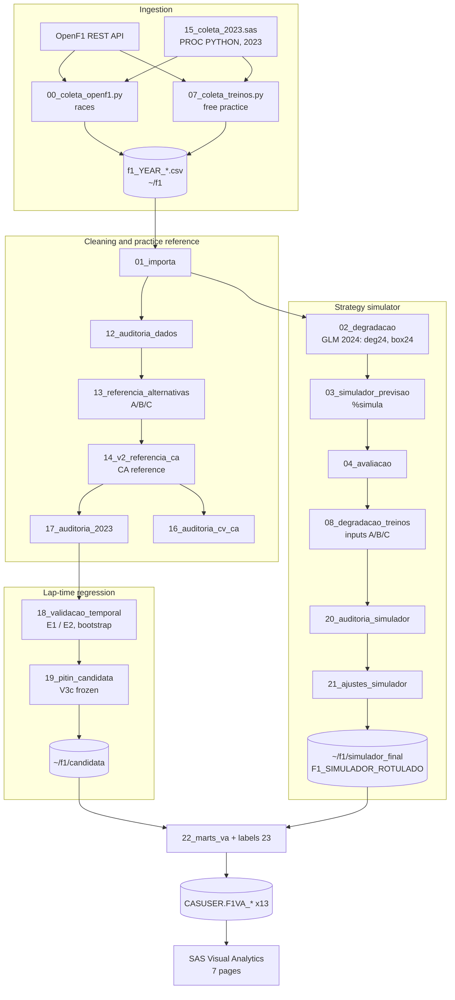

# Architecture

## Overview

The project is a batch analytics pipeline on SAS Viya, using SAS Viya for Learners.

1. **Ingestion.** Python scripts run inside SAS Studio (`PROC PYTHON`). They call the public OpenF1 REST API and write one set of CSV files per season to the SAS Studio home folder (`~/f1`).
2. **Processing and modelling.** SAS programs import the CSVs, apply the cleaning rules, build the practice reference and fit models. Most work happens in the SAS compute server WORK library; model fitting happens in CAS (`PROC REGSELECT`, `PROC FOREST`, `PROC GRADBOOST`).
3. **Freezing.** Final results are saved to permanent SAS libraries under `~/f1` (`candidata`, `temporal`, `simulador_final`, `benchmark_v1`).
4. **Serving.** Program 22 (and the unsaved label program "23") reshapes the frozen results into 13 single-grain marts. The marts are promoted to `CASUSER` and saved as `.sashdat`.
5. **Presentation.** A SAS Visual Analytics report reads the CAS marts directly.

There are **two analytical branches that do not feed each other**:

- the **lap-time regression branch** (practice reference → V3c → temporal validation);
- the **strategy-simulator branch** (2024 degradation GLM → `%simula` → 2025 retrospective).

## Data flow

Exploratory programs that informed the design but whose outputs are not in the dashboard: 03b (simulator v2), 05 (ML degradation), 06 (oracle), 09 (ML stop window), 10–11 (pre-race ML and Model Studio reproduction).

## Tools

| Tool | Role |
|---|---|
| SAS Studio | Program editor and runner; `PROC PYTHON` for ingestion |
| SAS compute server (WORK, permanent libraries) | DATA step and `PROC SQL` processing, `PROC GLM`, `PROC SURVEYSELECT` bootstrap |
| CAS | In-memory tables; `PROC REGSELECT`, `PROC FOREST`, `PROC GRADBOOST`; marts promoted for VA |
| SAS Model Studio | Early regression pipelines; re-implemented in code (program 11) for transparency |
| SAS Visual Analytics | Dashboard; report built and refined through the VA REST API (`/reports/reports/{id}/content`) |
| Python 3 + pandas | OpenF1 collection and cleaning rules |

## Program and table dependencies

| Program | Reads | Writes |
|---|---|---|
| 00 / 07 / 15 | OpenF1 API | `f1_<year>_*.csv` |
| 01 | CSVs | WORK `v24 v25 box24 box25 real24 real25 st24 st25 cl24 cl25` |
| 02 | `v24`, `v25` | `deg24`, `deg25`, `pe24` (GLM estimates) |
| 03 | `deg24`, `box24`, `real&a`, `pe24` | `sim24`, `sim25` (the 2024 summary table `CASUSER.F1_SIMULADOR` was derived from `sim24` in an earlier session; that load step is not in the repo) |
| 08 | practice CSVs, 02–04 outputs | inputs A/B/C, `prev25_*` |
| 12–14 | WORK tables from 01/08 | reference variants, V2 tables |
| 17 | `f1_2023_*` | `*23` tables |
| 18 | 2023–2025 tables from 14/17 | `~/f1/temporal/*` |
| 19 | 18 session | `~/f1/candidata/*` (V3c) |
| 20–21 | 03/04/08 outputs | `t1*–t5*` (WORK), `~/f1/simulador_final/*`, `F1_SIMULADOR_ROTULADO` |
| 22 (+23) | candidata, temporal, simulador_final, WORK | `~/f1/va_marts/*`, `CASUSER.F1VA_*` |

Programs run in **chained sessions**: later programs expect WORK tables and macro variables (`&offM`, `&ef_com`, `%boot`, …) created by earlier ones. The wrappers in `src/00_session_wrappers` rebuild a session after a timeout.

## VA report structure

| Group | Page | Main marts |
|---|---|---|
| Executive | 1 Overview | SEASON, MODEL_METRICS, MODEL_COMPARE, NOTES |
| Technical analysis | 2 Data & Quality | DATA_FUNNEL, PITIN_FIX, REF_BIAS_TEAM, SEASON |
| Technical analysis | 3 Tyre Degradation | TRACK, LAP_ERROR |
| Technical analysis | 4 Model Validation | MODEL_METRICS, MODEL_COMPARE, RACE_ERROR, LAP_ERROR |
| Strategy simulator | 5 Simulator 2024 (in-sample) | SIM2024 |
| Strategy simulator | 6 Simulator 2025 (retrospective) | SIM2025_HALVES, SIM2025_BASELINES |
| Method | 7 Method & Limitations | NOTES |

Filters are local to the charts whose grain they match, for example experiment and model on race-level error. No global filter crosses marts of different grains.
